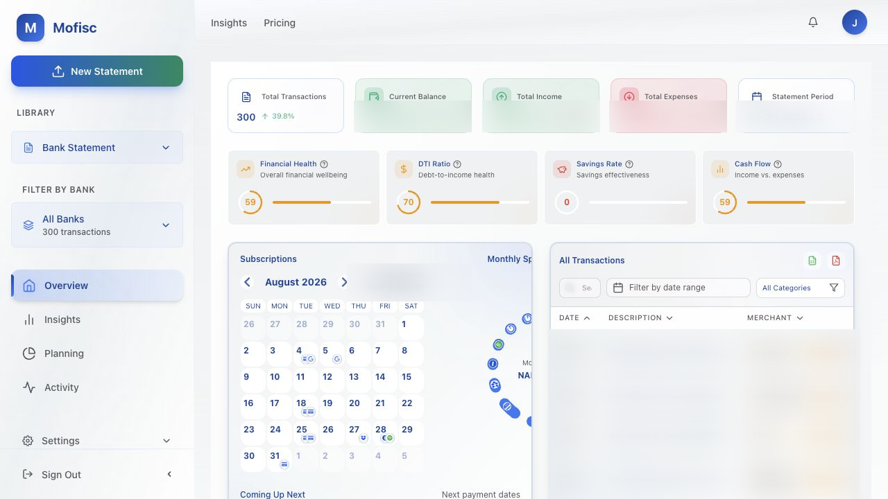
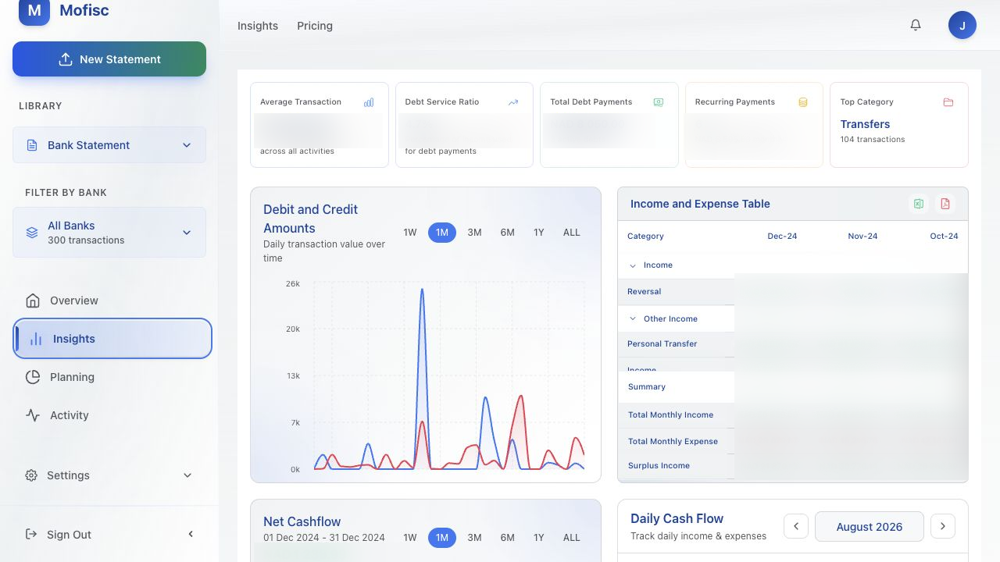

# Mofisc Web

Mofisc is a personal-finance workspace for reviewing bank-statement activity,
understanding cash flow, and planning budgets and savings goals. This
repository contains the React web application.

> **Project status:** active pre-release software. Use synthetic data when
> developing locally; do not upload real financial records to an environment
> you do not control.



## What is included

- Statement review, transaction categorisation, and cash-flow insights
- Budgets, savings goals, and repayment calculators
- Activity, achievements, subscriptions, and notifications
- Supabase authentication and data access
- Optional Firebase browser notifications and Sentry monitoring
- A public landing page with a short product demo

The authenticated product depends on the separate Mofisc API and a configured
Supabase project. The landing page and bundled demo video can be viewed without
running the API.



## Requirements

- Node.js 22.12 or later
- npm
- Mofisc API and Supabase configuration for authenticated features

## Run locally

```bash
git clone https://github.com/jpandeinge/mofisc-web.git
cd mofisc-web
cp .env.example .env
npm ci
npm start
```

Open <http://localhost:3000>. The development server proxies `/api` requests
to <http://localhost:8000>.

The values in `.env.example` are placeholders. Browser configuration is
public by design, but never place service-role keys, private API keys, or
server credentials in a `REACT_APP_*` variable.

## Configuration

| Variable | Required | Purpose |
| --- | --- | --- |
| `REACT_APP_API_URL` | Yes | Base URL for the Mofisc API |
| `REACT_APP_SUPABASE_URL` | Yes | Supabase project URL |
| `REACT_APP_SUPABASE_ANON_KEY` | Yes | Browser-safe Supabase key |
| `REACT_APP_FIREBASE_API_KEY` | For push | Firebase web configuration |
| `REACT_APP_FIREBASE_AUTH_DOMAIN` | For push | Firebase auth domain |
| `REACT_APP_FIREBASE_PROJECT_ID` | For push | Firebase project identifier |
| `REACT_APP_FIREBASE_STORAGE_BUCKET` | For push | Firebase storage bucket |
| `REACT_APP_FIREBASE_MESSAGING_SENDER_ID` | For push | Firebase messaging sender |
| `REACT_APP_FIREBASE_APP_ID` | For push | Firebase web app identifier |
| `REACT_APP_FIREBASE_VAPID_KEY` | For push | Browser notification VAPID key |

The service worker is generated by `scripts/generate-sw.js` before development
and production builds. Do not edit `public/firebase-messaging-sw.js` by hand.

## Commands

| Command | Purpose |
| --- | --- |
| `npm start` | Generate the development service worker and start Vite |
| `npm test -- --runInBand --watchAll=false` | Run the Jest suite once |
| `npm run test:security` | Run server and service-worker security tests |
| `npm run typecheck` | Type-check without emitting files |
| `npm run build` | Type-check and create the production build in `build/` |
| `npm run audit` | Audit production and development dependencies |

## Project map

```text
src/
  components/    Reusable product and layout components
  context/       Authentication, statements, notifications, and app state
  pages/         Route-level screens
  services/      API and integration clients
  styles/        Shared colours and themes
public/
  images/        Static product assets
  videos/        Landing-page demo video
scripts/         Build-time and security checks
remotion/        Source for product demo videos
```

Routes are declared in `src/App.tsx`. API calls and integration logic should
remain in `src/services/` rather than page components.

## Quality checks

Run the same checks before opening a pull request:

```bash
npm run typecheck
npm test -- --runInBand --watchAll=false
npm run test:security
npm run build
```

CI also audits the root and `remotion/` dependency trees.

## Deployment

The production image serves the static build on port `8080`:

```bash
docker build --target production -t mofisc-web .
docker run --rm -p 8080:8080 mofisc-web
```

Public configuration is embedded at build time. See
[`docs/VERCEL_PRODUCTION_DEPLOYMENT.md`](docs/VERCEL_PRODUCTION_DEPLOYMENT.md)
for the supported hosted deployment boundary and required controls.

## Security and privacy

- Use synthetic statements and identities in local development and tests.
- Never commit `.env` files, Firebase service-account JSON, private keys, or
  exported customer data.
- Treat screenshots as data exports: redact names, identifiers, balances, and
  transactions before committing them.
- Report security issues privately as described in [`SECURITY.md`](SECURITY.md).

## Contributing

See [`CONTRIBUTING.md`](CONTRIBUTING.md) for the development workflow and pull
request expectations.

## License

Released under the [MIT License](LICENSE).
